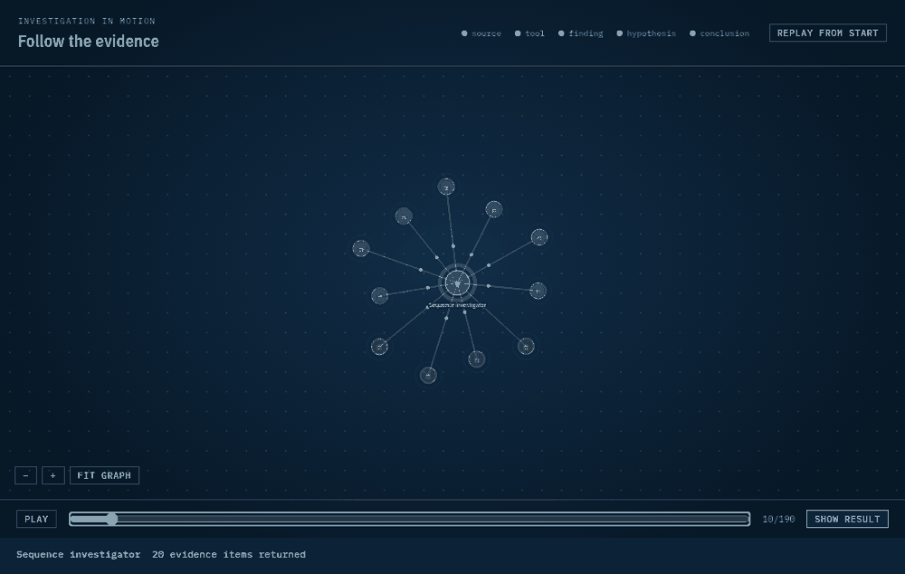
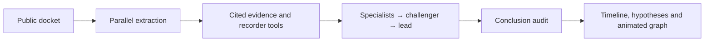

# Docket Blueprint

[](https://github.com/DanielD0304/docket-blueprint/actions/workflows/ci.yml)

Turn a public NTSB docket into a cited timeline, recorder analysis and competing accident explanations. Gemini extracts document and media evidence; Python analyzes flight data; an investigator team researches relationships through read-only tools. Every finding remains inspectable through its source citation.



**Start here:** [See every screen in action](docs/TOUR.md) · [Architecture and technical depth](docs/ARCHITECTURE.md) · [Investigator team and run review](docs/INVESTIGATOR_TEAM.md)

| Explore | What you will find |
|---|---|
| [Visual tour](docs/TOUR.md) | Home plus all seven views, screenshots and usage explanations |
| [Architecture](docs/ARCHITECTURE.md) | Pipeline, agent topology, recorder processing, provenance and replay diagrams |
| [Team investigation](docs/INVESTIGATOR_TEAM.md) | Tool access, budgets, evidence handoffs, observed results and limitations |
| [UI behavior](docs/UI.md) | Playback, clock alignment, display smoothing and annotation rules |
| [Plan](PLAN.md) | Design background, goals and future work |
| [Contributor notes](AGENTS.md) | Setup pitfalls, schemas, citations and repository rules |

**Current state:** a working research prototype with real Atlas Air 3591 evidence, concurrent extraction, native recorder analysis, separate fusion experiments, a five-agent investigator team and replayable activity. Generated causal links and conclusions require review. Citation checks establish provenance; they do not establish causation. The first team run produced 20 proposed links and four hypotheses in 491 seconds; review found scope and causal-direction errors. [Read the evaluation and limits](docs/ARCHITECTURE.md#evaluation-and-practical-limits).



---

## Quick start

### 1. Backend (Python 3.12+)

```bash
cd backend
python -m venv .venv
.venv/Scripts/python -m pip install -r requirements.txt      # Windows; .venv/bin/python on Mac/Linux
cp .env.example .env                                         # set GEMINI_API_KEY (never commit .env)
.venv/Scripts/python -m uvicorn app.main:app --port 8000
```

Without `GEMINI_API_KEY` (or with `MOCK_LLM=1`) the backend runs a **mock extractor**. It is regex based but works on the real document text, so the full pipeline and UI run offline. It adds no cost.

Models: the hackathon key exposes `gemini-4-argon`, `gemini-4-carbon` and `gemini-4-hydrogen`. Defaults are `GEMINI_MODEL_FAST=gemini-4-hydrogen` (fastest in a quick test) and `GEMINI_MODEL_PRO=gemini-4-argon`. The codenames don't say which is which, so this is a guess.

### 2. Frontend (Node 22.18+; tests import .ts directly)

```bash
cd frontend
npm install
npm run dev          # http://localhost:5173, proxies /api -> :8000
```

If port 8000 is occupied, start the backend with `--port 8001` and run
`DOCKET_API_URL=http://127.0.0.1:8001 npm run dev` from `frontend` (Mac/Linux).

On this NixOS checkout, `source backend/.venv/bin/activate` from the repository
root also enables the installed Node runtime and the native libraries needed by
NumPy. Run this in each terminal before starting either service.

`http://localhost:5173/#sample` opens **synthetic demo data** (marked with a red banner) for UI work without a backend.

Deep links: `#case=<id>&t=<seconds UTC>&cam=chase|side|top|orbit&view=flight|profile|sensors|causal|hypotheses|activity|sources`

### 3. Demo case: Atlas Air 3591 (DCA19MA086)

```bash
backend/.venv/Scripts/python scripts/fetch_docket.py DCA19MA086                 # 78 items, ~1.5 GB -> <DATA_DIR>/dockets/DCA19MA086
cd backend
.venv/Scripts/python -m app.cli DCA19MA086 --title "Atlas Air 3591" --ntsb DCA19MA086 --date 2019-02-23 --aircraft "Boeing 767-375BCF" --offset -6
```

Or use the UI: **Analyse local folder** (the parameters are prefilled), or `POST /api/cases/local`. A first full run with Gemini takes about 15 minutes: around 130 PDF chunks at roughly 50 s each, 32 agents in parallel (`MAX_CONCURRENCY`), plus 7 media files (the ATC audio alone takes about 15 minutes). Results are cached per job in `<DATA_DIR>/cases/<id>/atoms/`, so **Rerun pipeline** reuses valid extraction caches and refreshes outdated recorder tools. Gemini results are also shared across runs in `<DATA_DIR>/atom_cache/`, so a **new** run of an already analysed docket finishes extraction in under a minute.

**Data location:** dockets and case outputs live in `DATA_DIR`, which defaults to `~/DocketBlueprintData`. That keeps them outside the repo and outside synced folders like OneDrive. Set it in `backend/.env`. Short names like `DCA19MA086` resolve to `<DATA_DIR>/dockets/DCA19MA086` in the CLI and the UI. **Analyse local folder** only reads below `DATA_DIR` unless you add more roots with `LOCAL_CASE_ROOTS`.

### Re-run the investigator without re-extracting

The CLI default final fusion step is a bounded investigator (8 turns, at most 3 tool
requests per research turn). It can search/inspect cited evidence, inspect a
timeline window across sources, read PDF
passages, and ask Python for recorder-window statistics. It tests relationships
before returning the causal graph and hypotheses. Claims referencing evidence
it has not inspected are discarded. Recorder summaries use cached, downsampled
profile samples and are labelled accordingly.

Use `--fusion team` for three concurrent specialists, a challenger, lead synthesis and a conclusion audit. The UI fusion rerun selects this mode. See [the team guide](docs/INVESTIGATOR_TEAM.md).

From the repository root on Mac/Linux:

```bash
source backend/.venv/bin/activate
cd backend
python -m app.refuse --from-case atlas-3591 --case-id atlas-investigator-v1 --max-turns 8
# Compare with the original single-pass linker using the same base extractions:
python -m app.refuse --from-case atlas-3591 --case-id atlas-linker-v1 --fusion linker
# Free tool/replay smoke test (no fabricated causal findings):
MOCK_LLM=1 python -m app.refuse --from-case atlas-3591 --case-id test-investigator-v1
```

Each experiment requires a **new case ID**, preserves the source case, and records
its base-case ID and extraction digest in `stats`. New runs save
`extractions.json` before fusion changes clocks or merges atoms. Completed older
runs rebuild from the exact extraction jobs in their event log and caches;
missing caches fail rather than triggering paid extraction. No source inventory,
triage, extraction or media upload is performed by `app.refuse`. PDF verification
and investigator page reads still require the original docket files.

In the UI, **Rerun fusion** creates a separate team experiment through
`POST /api/cases/{id}/fusion-runs` (`{"fusion":"team","max_turns":8}`).
The Agent activity view shows an evolving node graph of public tool activity, cited evidence and results. **Replay demo** animates just these steps without model
calls. Both the trace and source links persist in the graph and event log, and
CLI runs stream live to the browser. The trace is a public activity record, not
private model reasoning. The full-pipeline **Rerun pipeline** button still exists.

ADS-B series with an unresolved `MM:SS` clock are withheld from the UTC Profile
until their hour is matched against FDR altitude. Live extraction publishes the
aligned preview as soon as both data sources are available.

## Development and quality gates

Every push and pull request runs [CI](.github/workflows/ci.yml): ruff lint, backend tests,
frontend type-check, tests and production build, plus a secret scan. CI never calls Gemini.

```bash
make setup     # venv + backend/requirements-dev.txt + npm ci
make check     # exactly what CI runs: ruff, tsc, pytest, node --test
```

Without `make` (Windows):

```bash
cd backend && .venv/Scripts/python -m pip install -r requirements-dev.txt
.venv/Scripts/python -m ruff check . && .venv/Scripts/python -m pytest
cd ../frontend && npm run check && npm run build
```

| Suite | What it pins down |
|---|---|
| `tests/test_pipeline_e2e.py` | Synthetic docket through the full `CaseRunner` (mock LLM): UTC clock, upset detected as a *measured* anomaly, ancillary data excluded, **every atom has a citation** |
| `tests/test_table.py`, `test_timeparse.py` | NTSB FDR quirks (metadata, units, enum rows, `(CST)` local clock, sparse rows) and ADS-B `MM:SS` hour rollover |
| `tests/test_ingest.py` | Triage roles, blind mode, ancillary exclusion, zip-slip and nested archives |
| `tests/test_api.py` | FastAPI routes: health, 404s, local-folder intake, request validation |
| `tests/test_schema_mirror.py` | `frontend/src/types.ts` cannot drift from `app/schemas.py` |
| `tests/test_sensors.py`, `test_discovery.py`, `test_team.py`, `test_investigator.py`, ... | Recorder statistics, evidence gating, LLM timeouts and resumable runs |
| `frontend/tests/*.test.mjs` | Ground-track smoothing, interpolation, profile quality, activity graph |

Tests use pytest: `tests/conftest.py` gives each run an isolated temporary `DATA_DIR`
and forces the mock LLM, so the suite never touches real cases or a paid API.
A per-test timeout (pytest-timeout, 120 s) fails a hung async test instead of blocking.
In sandboxes that block loopback sockets (Windows asyncio needs them), async tests are skipped
with that reason instead of hanging; `DOCKET_TEST_SIMULATE_NO_LOOPBACK=1` reproduces this.

**Security model:** a local, single-user workstation tool with no authentication. The API serves
CORS only to the dev UI origins (`CORS_ORIGINS`), reads local dockets only below `DATA_DIR` /
`LOCAL_CASE_ROOTS`, rejects zip-slip paths, and tracks running jobs in-process (one worker).
Do not expose it on a shared network without adding auth and a job queue.

---

## How it works

```
docket folder / zip
  └─ ingest      inventory (sha256, kind, pages, scanned?) → triage (filename rules, LLM fallback) → blind mode / ancillary hold-out
  └─ extract     priority queue, N async workers
        PDF chunk (20 pp)  → Gemini structured output (Extraction schema), role-specific prompt
        video / audio      → Gemini File API, citations carry media_time
        FDR CSV            → tools/fdr.py   (deterministic: discretes, exceedances, 20+ series, lat/lon track)
        ADS-B CSV          → tools/track.py (track, MM:SS clock, ADS-B v2 autopilot discretes)
        radar .ppb         → tools/radar.py (STARS playback, filtered by Mode-S address)
  └─ fuse        clock_anchor (ADS-B hour via altitude match) → verify (quote vs. page text) → align (clocks via anchor events)
                 → dedup (merge events across sources, conflicts) → link (Gemini: HFACS layers, causal edges, hypotheses)
  └─ case_graph.json  +  events.jsonl (SSE stream, replayable)
```

Core rule: **every atom (event / anomaly / fact) carries a citation**: file, page or media time, and a verbatim quote. The verifier checks each quote against the PDF text. The UI shows the origin of everything with source chips (`CVR #68 p.12 ✓`, `FDR #67 data ⚙`).

### Repository layout

```
backend/app/
  main.py            FastAPI: /api/cases (upload) · /api/cases/local · /api/cases/{id} · /stream (SSE) · /events · /files/{file_id}
  cli.py             headless run
  orchestrator.py    the pipeline above; emits progress events
  schemas.py         ALL data models (LLM-facing + stored). Frontend mirror: frontend/src/types.ts
  store.py           file-based case store + SSE event bus
  config.py          env config
  pdfutil.py         pypdf wrapper (PyMuPDF DLL is blocked by Windows app control on the dev laptop)
  timeparse.py       raw time strings → seconds since 00:00 UTC of accident date
  ingest/            unzip, inventory, triage (role rules), chunker
  agents/            llm.py (Gemini wrapper: structured output, retries, File API), prompts.py, extractor.py, atoms.py, mock.py
  tools/             table.py (robust NTSB CSV loader), fdr.py, track.py, radar.py
  fusion/            clocks, verification, dedup, linker baseline, bounded investigator, team orchestration
frontend/src/
  App.tsx            console layout: header · view + timeline strip · inspector
  useCase.ts         live state: applies SSE messages to the case graph; replay
  data.ts            derived views: series lookup, discrete states, aircraft zones, provenance (sourceOf)
  views/             FlightView (three.js hero), TimelineStrip (transport + lanes), Sources (swarm, log, media preview)
  sheets/            CausalGraph (layered DAG), Profile (parameter bands)
  components/        cards (ADI, system cards), SourceTag (provenance chip)
  panels.tsx         Header, Inspector (register / detail with evidence)
  sample.ts          synthetic demo data (clearly labelled)
scripts/fetch_docket.py   download any public NTSB docket
docs/UI.md                UI requirements
```

---

## Historical baseline and remaining work (2026-11-14)

**Working:**
- End-to-end pipeline (mock and Gemini).
- Real Atlas 3591 data: the FDR CSV (CST→UTC, 20 series, lat/lon track), ADS-B with hour recovery (missing-hour recovery; fine timing offsets still need review), the radar `.ppb`, and media extraction.
- Live SSE UI.
- 3D flight view with orbit controls in all camera modes, satellite/street basemap controls and time marks.
- Layered causal graph and source chips on every item.

**First full Gemini run on Atlas 3591** (local only, in `DATA_DIR`):
- 25 min, 141 calls, about 2.6 M input tokens.
- 1,668 events, 332 anomalies, 24 causal links, 3 hypotheses. The leading model explanation was inadvertent go-around → somatogravic illusion → nose-down inputs; its confidence was not calibrated.
- The ATC audio was aligned to UTC through 3 anchors with 0.2 s spread.
- This was not a blind test: the docket has no final report, but party submissions discuss the theory.

**Open / next** (see [AGENTS.md](AGENTS.md) for details):
- Evaluate causal direction, evidence entailment and uncertainty; link count is not an accuracy measure.
- Check satellite and street basemap rendering and contrast.
- Blind-mode evaluator: compare findings with the NTSB final report.
- Learned anomaly detection on FDR data (TimesFM etc.), see PLAN.md §11.
- Gemini context caching, an LLM conflict detector, a PDF.js viewer with quote highlight.

### Basemap tiles and caching

The 3D path view defaults to EOX Sentinel-2 cloudless **2016** satellite imagery
(CC BY 4.0), with a Satellite/Streets switch. This is geographic context, not
accident-date imagery. EOX provides a token-free, best-effort service; see
[EOX::Maps](https://maps.eox.at/) for attribution and service details.

The Streets option loads standard OpenStreetMap raster tiles directly from
`https://tile.openstreetmap.org/{z}/{x}/{y}.png` without an API key. Normal browser
HTTP caching persists tiles across visits, honours the server's cache headers,
and revalidates expired tiles. Keep browser caching enabled (including in DevTools)
to reuse them. No tile prefetch or offline download is provided. Attribution links
to the OSM copyright page. See the [OSM tile usage policy](https://operations.osmfoundation.org/policies/tiles/).

### Recorder time-series discovery

FDR extraction now runs `tools/discovery.py` on native, non-null sensor samples
before display downsampling. It compares native-interval and approximately
five-second change rates against a robust whole-recording baseline (median,
MAD and IQR). A capped recorded-step floor and numerical floor handle quantized
or flat baselines. Scores of at least 8 produce informational candidates, capped
at three episodes per channel and 40 overall, giving distinct channels priority.

Candidates appear in the existing anomaly register and investigator evidence
search. Each includes parsed data-row ranges for the measurement and baseline,
column, rate, scale, algorithm version and UTC observation interval. Row numbers
exclude CSV metadata, header, units and enum rows. These are measured statistical
changes, **not failure probabilities or aircraft-limit violations**. Normal
maneuvers, ground operation and sensor artifacts can trigger them; the baseline
is retrospective, spans flight phases, and is not a normal-flight reference.
The overview detector does not detect cross-sensor inconsistencies. The per-sensor
layer below also checks rare levels, including plateaus with no continuing change.

No forward filling or interpolation is used. Gaps longer than three median
sample intervals, repeated timestamps and backwards clocks split runs. Circular
heading/wind-direction channels are unwrapped within runs. Missing/short or
undimensioned channels, switches, selected targets and non-second clocks are
excluded. No new dependencies or model calls are needed.

**Rerun pipeline** the extraction pipeline to refresh old deterministic FDR caches;
PDF/media caches stay reusable. **Rerun fusion** and `app.refuse` preserve
the original extraction snapshot, so they do not add discovery to an old case.

Underused Atlas 3591 sensors and promising follow-on analyses:

| Channels actually present in item 67 | Next analysis |
|---|---|
| `Accel Lat`, `Accel Long`, `Accel Vert` | Joint acceleration episodes, coordinated-turn and energy consistency |
| `Elevator-L/R`, four ailerons, `Rudder`, `Rudder Ped Pos`, column/wheel | Left/right asymmetry and input-to-surface response lag |
| Engine N1/N2/EGT and TRA for both engines | Paired-engine divergence and throttle-to-spool response |
| Three hydraulic pressures/quantities, AC bus voltages | Sustained drops and agreement with control-surface behaviour; sparse sampling limits timing |
| Pressure/radio altitude, airspeed, groundspeed, pitch, AoA | Unit-aware kinematic residuals, with explicit terrain/wind/sensor assumptions |
| Autopilot/autothrottle modes and MCP selections | Mode-conditioned baselines and commanded-versus-observed behaviour |

The new discovery layer covers eligible continuous channels in these groups;
paired-channel, physical and mode-conditioned analyses remain future work.


### Per-sensor states and anomalies

The **Sensors** view keeps every recorder channel separate by source file and
column. Search channels, filter to channels with findings, inspect recorded
samples and observed state intervals, jump the shared playback cursor, and open
source-row citations. Existing cases need a pipeline **Rerun pipeline** to populate it;
fusion-only reruns intentionally retain the original extraction snapshot.

`tools/sensors.py` computes on native rows:

- **Continuous states:** stable, rising, falling, variable, or insufficient
  samples in approximately five-second observed-time windows (longer for sparse
  channels). Thresholds adapt to the channel's typical activity and recorded
  steps. Adjacent compatible windows merge; distinct plateaus stay separate.
- **Discrete states:** exact recorded values, including the initial value;
  these are not assigned aircraft-mode meanings by the detector.
- **Unusual changes:** native-interval and approximately five-second rate rarity.
- **Rare levels:** contiguous samples at least eight robust scales from the
  whole-recording median; circular channels skip absolute-level testing.
- **Sampling gaps:** elapsed time greater than three median sample intervals.
  Empty cells in an interleaved sparse export are not interpreted as dropouts.

Each channel retains up to 12 findings per detector, independent of the global
40-candidate overview. State output is capped at 2,000 intervals per channel;
truncation is explicitly recorded. Baselines require 60 samples. Short channels
can still report descriptive states and sampling gaps. Unsupported units with
high-cardinality values are listed as unsupported rather than treated as numeric
sensors; unresolved clocks produce inventory only. Heading/wind/drift channels
are unwrapped per uninterrupted run. Latitude/longitude may be displayed as
continuous states, but the existing rate detector excludes them.

States, findings, method, limitations, cadence and source citations persist in
`CaseGraph.sensors`, extraction snapshots, job caches and live/replay SSE events.
Older cases default to an empty list. The investigator's `sensor_window` tool
accepts an exact sensor ID or column via `series_name`, source `file_id`, and UTC
window. It returns cited, native-row evidence; display points remain downsampled.
All arithmetic stays in Python. State labels describe signals, not health or
causation; a sampling gap is not proof of a failed sensor. Physical limits and
cross-sensor consistency remain separate analyses.

### If a case stays at extracting

Extraction waits for every job, so the last PDF chunk or media request can keep the stage open after most files finish. Check Sources for unfinished jobs. Gemini requests have a configurable per-request limit (`GEMINI_REQUEST_TIMEOUT_S`, default 480 seconds) and bounded retries; media processing can also add waiting time. A request timeout is not a total-case deadline.

Runs currently execute in the backend/CLI process, not a durable job service. Restarting that process interrupts its work. Graceful cancellation now saves an error with a resume instruction; hard termination can still leave stale `running` metadata. **Rerun pipeline** reuses valid per-job caches and retries missing work. Do not delete caches to recover an interrupted run. Durable worker leases and crash reconciliation remain open work.

For a stopped case with a saved inventory, a guarded CLI recovery avoids inventory and triage entirely and limits new model jobs:

```bash
cd backend
python -m app.resume --case-id YOUR_CASE --max-new-jobs 2 --fusion team
```

This refuses cases still marked running, preserves the previous graph/event log as local backup files, restores cached payloads once, retries missing jobs, then saves a complete extraction snapshot and runs fusion. It aborts before starting if the number of missing model jobs exceeds the limit. Establish that the previous worker actually exited before changing an interrupted case's status; a server draining on shutdown may still be executing requests.

### Recorded demo mode

Start the backend with `DEMO_MODE=1 DEMO_CASE_ID=<completed-case-id>` (or set these in `backend/.env`). The selected case must already be complete and retain its event log. Uploading files or choosing **Analyse local folder** then opens that recorded case and automatically runs the single **Replay demo** action: a fast source-processing replay followed by the animated investigator graph, compressed into about 18 seconds. Replay makes no model calls. Intake is labelled recorded demo mode; it does not claim to analyze the newly supplied folder. Outside this flag, intake performs real analysis.

Long WAV recordings are now divided into five-minute requests, with at most three media requests in flight. Chunk outputs are cached under ignored `data/media_chunks/`, and citation seek positions are shifted back to the original recording. A failed chunk can be retried without discarding completed chunks.
