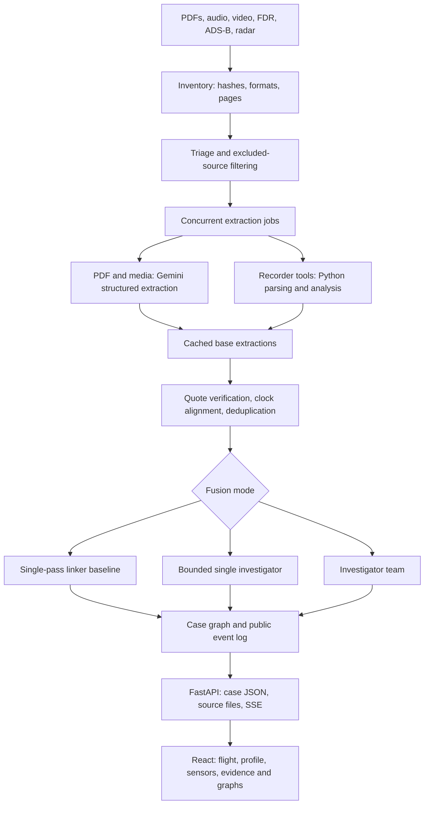
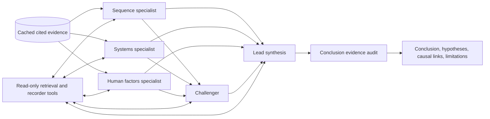
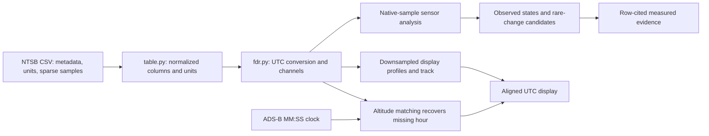
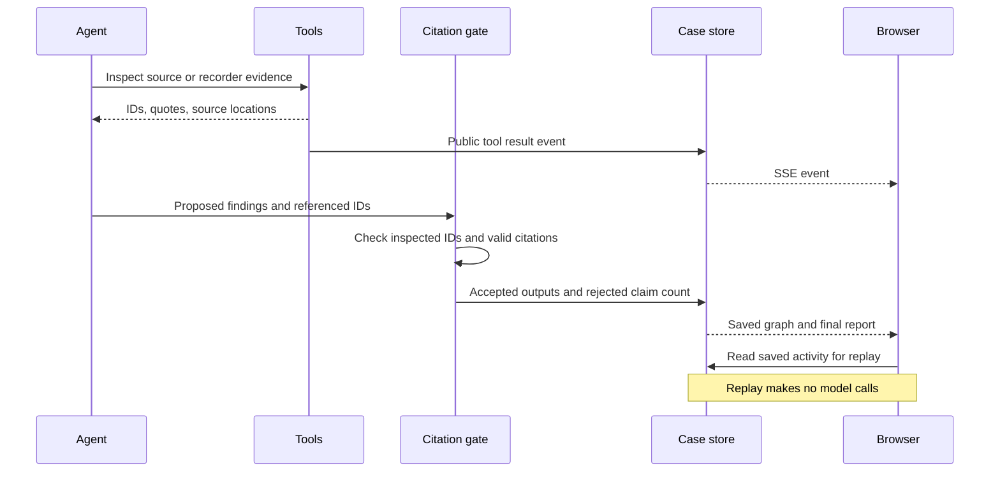

# Architecture and technical depth

[Visual tour](TOUR.md) · [README](../README.md) · [Investigator team](INVESTIGATOR_TEAM.md)

Docket Blueprint combines structured evidence extraction, deterministic recorder analysis and bounded model investigation. The output is an inspectable evidence graph with source citations and a saved public activity trace. A citation establishes provenance; it does not certify a generated causal explanation.

## From docket to investigation

The CLI and API use the same orchestrator. Extraction jobs are cached independently. Fusion experiments start in a new case from an immutable extraction snapshot, record the base digest, and preserve the original result. They still need the source files for verification and page reads.

## A team with evidence handoffs

The first three specialists run concurrently. Each has a separate inspected-evidence registry. Cited findings and their evidence are handed to the challenger and lead; agents can retrieve more material independently. Findings with unread evidence IDs are rejected. The initial team ceiling is 26 model calls: five turns per agent and one conclusion audit. Up to three tool requests are accepted per research turn. The single investigator and linker remain available for comparisons.

| Tool | What it provides | Bound or limitation |
|---|---|---|
| `list_sources` | Eligible source inventory | Excluded material remains unavailable |
| `search_evidence` | Cited candidate atoms | Up to eight matches; retrieval ranking is not relevance proof |
| `inspect_evidence` | Full evidence descriptions and quotes | Up to eight IDs |
| `timeline_window` | Events and anomalies in a UTC window | Bounded window and result count |
| `read_page` | Source passages with page provenance | PDF text extraction; not a visual interpretation |
| `recorder_window` | Python-computed recorder statistics | Cached downsampled profiles; not exact native peaks |

This is tool-directed research with bounded decisions and handoffs. The public trace records objectives, requests, returns and outputs; it does not expose private model reasoning. The animated graph is a presentation of those recorded actions, not a simulated investigation.

## Recorder analysis and clock handling

The recorder work is deterministic Python. NTSB FDR rows are sparse and differently sampled by channel; clock units can be local time. ADS-B can omit the hour entirely. Unresolved partial clocks are withheld from the UTC profile until aligned.

Native sensor analysis distinguishes states, gaps and statistical change candidates. Robust change discovery compares rates with a retrospective median/MAD/IQR baseline, handles circular channels and recording gaps, and caps candidate counts. It is not a trained failure classifier, a normal-flight reference or a physical aircraft model. Display interpolation and GPS smoothing do not rewrite the source evidence.

## Provenance and replay

PDF citations carry pages; media citations carry seek positions; tool evidence cites parsed rows or cached sample ranges. Quote matching can flag or drop unsupported extracted atoms. It cannot establish that the cited passage entails an inference, that an interview is accurate, or that a source is independent.

## Evaluation and practical limits

The first Atlas team run used the same base digest as the earlier single investigator: 23 model calls, 54 tool calls, 343 retrieved IDs across 33 of 76 eligible sources, 14 page-read calls and five recorder checks. It finished in 491 seconds with 20 proposed links and four hypotheses. A subsequent conclusion audit corrected an overgeneralized angle-of-attack statement. See [the run review](INVESTIGATOR_TEAM.md#first-atlas-evaluation).

These are observed coverage and runtime measurements, not accuracy scores. Causal review still found directional errors, overlapping events treated as distinct stages, and overly confident statements about inferred mental processes. The agents share a model and can share errors. A blinded comparison against an authoritative final report and systematic edge entailment evaluation remain open. Party submissions can reveal accident theories even when the final report is excluded.

## Code map

| Concern | Entry point |
|---|---|
| API and orchestration | [main.py](../backend/app/main.py), [orchestrator.py](../backend/app/orchestrator.py) |
| Shared models | [schemas.py](../backend/app/schemas.py), [types.ts](../frontend/src/types.ts) |
| Model integration | [llm.py](../backend/app/agents/llm.py), [prompts.py](../backend/app/agents/prompts.py) |
| Team and citation admission | [team.py](../backend/app/fusion/team.py), [investigator.py](../backend/app/fusion/investigator.py) |
| Research tools | [investigation.py](../backend/app/tools/investigation.py) |
| Sensors and discovery | [sensors.py](../backend/app/tools/sensors.py), [discovery.py](../backend/app/tools/discovery.py) |
| Reproducible fusion | [refuse.py](../backend/app/refuse.py), [store.py](../backend/app/store.py) |
| Live state and replay | [useCase.ts](../frontend/src/useCase.ts) |
| Moving investigation graph | [AgentActivity.tsx](../frontend/src/views/AgentActivity.tsx), [activityGraph.ts](../frontend/src/views/activityGraph.ts) |
