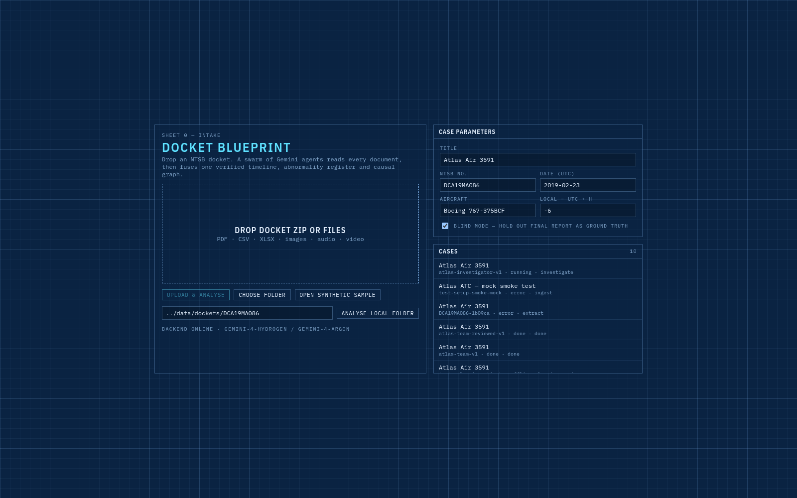
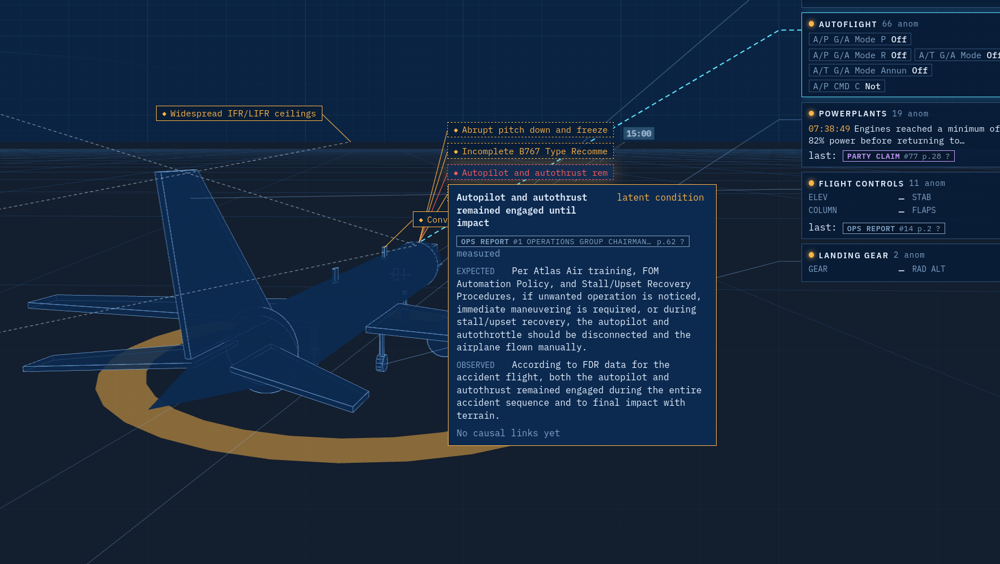
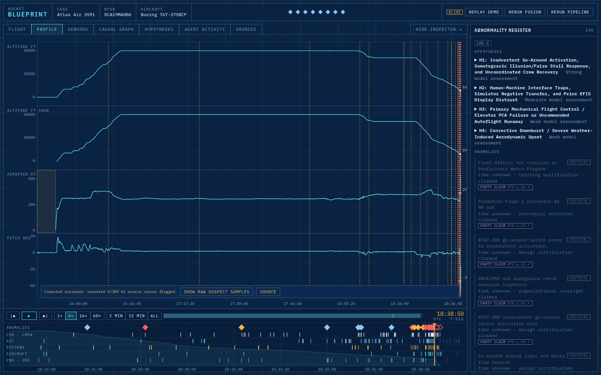
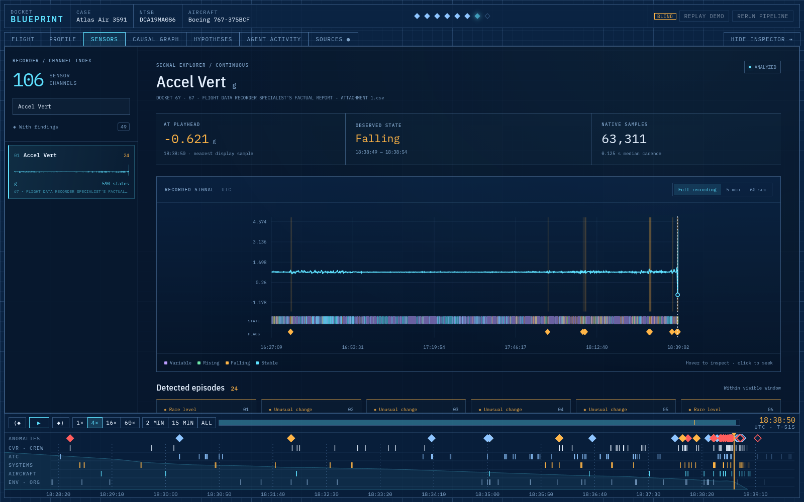
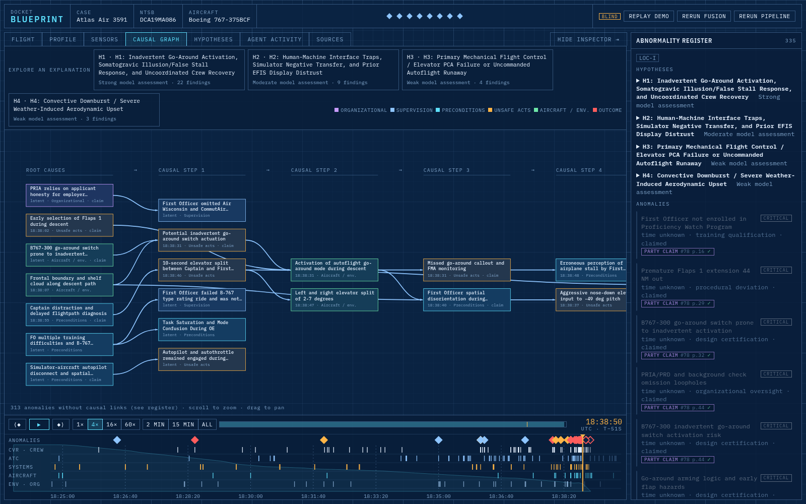
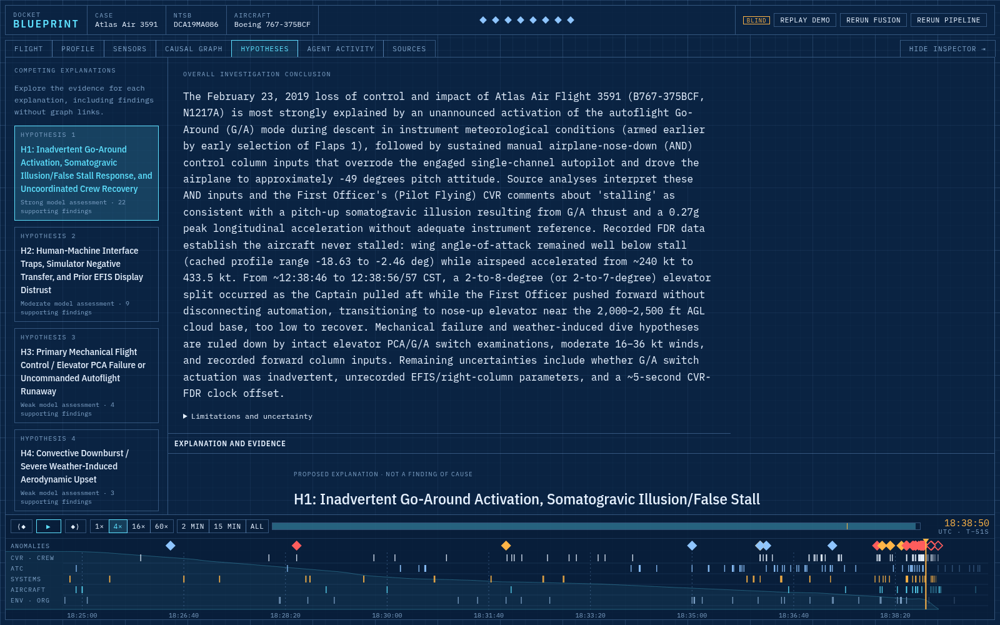
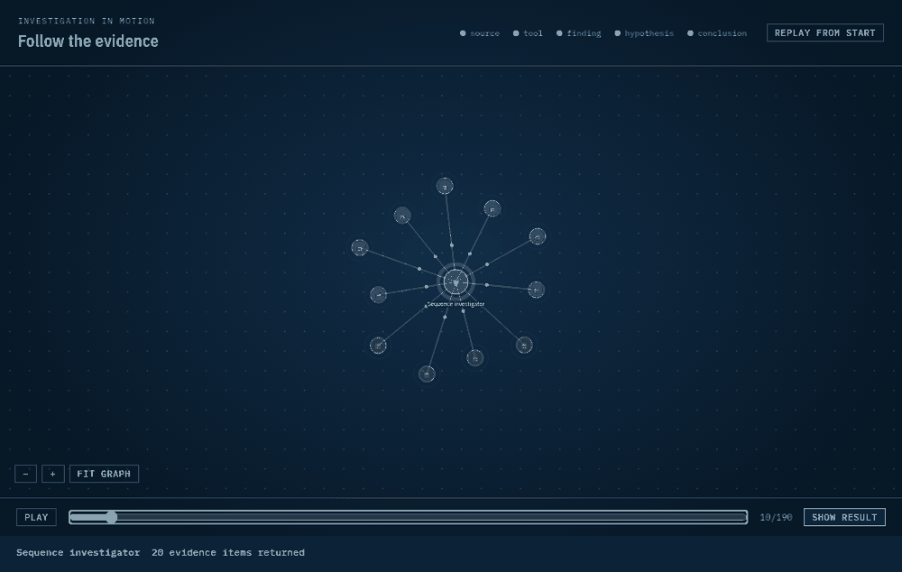
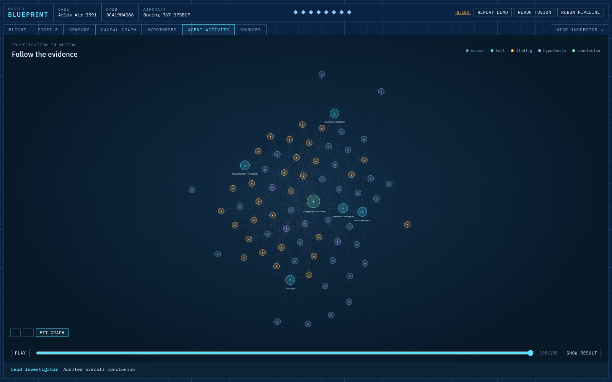
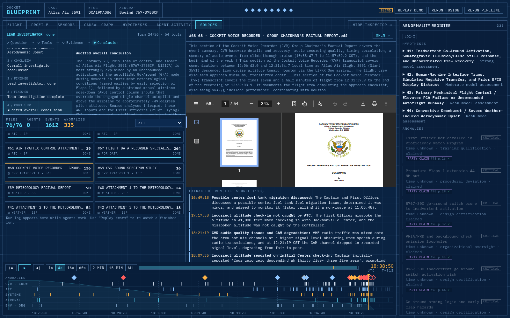

# Application tour

[README](../README.md) · [Architecture and technical depth](ARCHITECTURE.md) · [Investigator team](INVESTIGATOR_TEAM.md) · [UI behavior](UI.md)

These images show the local application using public Atlas Air 3591 docket evidence. They are screenshots, not mockups. Case outputs and source downloads are intentionally absent from git; reproducing a live case requires downloading and processing the docket. Most images use `atlas-team-reviewed-v1`; Sensors uses `atlas-investigator-v1`, which contains the newer per-sensor analysis. Flight is an earlier user-provided capture, explicitly noted below.

## 1. Home — open or start a case



Start from a local docket folder or uploaded files, open a saved case, or use the clearly labelled synthetic sample. Saved cases let you compare experiments without replacing the previous result. The many local experiment cases in this capture are development artifacts, not bundled datasets.

## 2. Flight — spatial and operational context



The 3D flight view combines a recorded track, aircraft attitude, system summaries and evidence annotations. The shared playback clock controls its position and the timeline. Source chips connect an annotation to its original evidence. Display smoothing helps playback without rewriting recorder samples.

**Capture note:** this image was supplied by the user from an earlier local build. The current automated capture environment cannot create a WebGL context; this image documents the view, but is not verification of the latest 3D rendering. Its annotation layout predates subsequent fixes. Satellite imagery is geographic context, not accident-date weather.

## 3. Profile — compare measurements over time



Compare altitude, airspeed, pitch and other channels against the same UTC cursor and evidence markers. Source-quality notices and raw-data controls distinguish suspicious samples from smoothed display interpolation. ADS-B data with an unresolved hour is withheld until aligned; the source's partial clock must not be mistaken for UTC.

## 4. Sensors — inspect native channels and detector evidence



Search recorder channels, inspect their native-sample states and candidate findings, and open row-cited evidence. The plot is downsampled for display; the state and change analysis uses native samples. Statistical rarity is not a failure probability. The method and limitations travel with the report. This capture uses a case with the newer deterministic sensor analysis; older extraction snapshots do not acquire it through a fusion-only rerun.

## 5. Causal graph — inspect proposed relationships



The layered graph organizes proposed causal relationships and HFACS context. Selecting a node exposes the observation and its provenance. Links are model proposals, not established accident findings; confidence values are model judgments, not calibrated probabilities. Direction, duplicate events and evidence entailment still need review.

## 6. Hypotheses — compare explanations and their evidence



Read the overall conclusion, compare competing explanations, and see how evidence supports, challenges or contextualizes each hypothesis. Per-item explanations cover facts and source passages even when they have no causal-graph edge. Expand quotes to inspect provenance instead of inferring support from a highlight alone.

## 7. Agent activity — watch the investigation unfold





Five agent hubs represent the sequence, systems and human-factors specialists, challenger and lead. Source, finding and result nodes emerge as recorded work progresses; links represent reads and shared cited evidence. The force layout changes as the network grows. Pause, scrub, drag nodes, zoom, or select a node for its evidence. Labels appear around current activity, hover and selection to reduce clutter.

**Replay demo** first replays source processing, then switches to the graph without calling Gemini. **Show result** reveals the completed network. This is a public record of tool activity and outputs, not private model reasoning. A screenshot captures one state of the animation; run the view to see the graph evolve.

## 8. Sources — inspect processing and original material



Inspect source roles, processing status, extraction jobs, usage and logs. Source selection opens the document or media preview; citations can seek to a page or media position. Excluded material and failures remain visible so missing evidence is not silently presented as reviewed.

## Try the tour locally

Run the backend and frontend using the [quick start](../README.md#quick-start). The usual frontend is `http://localhost:5173`; Vite may choose another port if it is occupied. Open a completed case, then use the tabs above. Deep links accept `#case=<id>&view=flight|profile|sensors|causal|hypotheses|activity|sources` and an optional UTC cursor `&t=<seconds>`.

The screenshot cases are local experiment IDs, not preinstalled examples. `#sample` is available without a case download and remains labelled synthetic. Mock extraction exercises the pipeline but does not produce a genuine investigator conclusion.

## Screenshot maintenance

Captures were assembled on 2026-11-14 at 1600×1000; Flight retains its original user-supplied dimensions. Refresh this tour when tabs, labels or analysis behavior change. Check that the intended case is loaded and each image contains actual content; a blank renderer or empty old extraction snapshot is not an acceptable replacement. Never capture API keys, local environment files or private uploaded evidence.

A refresh helper is available at [scripts/capture_docs.mjs](../scripts/capture_docs.mjs). It uses Playwright installed separately in `frontend` (or the `PLAYWRIGHT_MODULE` environment variable pointing to its module) and a browser installed by Playwright (or `CHROMIUM_PATH`). With both local servers running:

```bash
DOCS_BASE_URL=http://127.0.0.1:5173/ \
DOCS_CASE_ID=your-completed-case \
DOCS_SENSOR_CASE_ID=your-case-with-sensor-analysis \
node scripts/capture_docs.mjs
```

The helper waits for each view before capturing, selects a sensor and source, and fails on browser errors. Its Atlas-specific selections (`Accel Vert` and the CVR report) should be adapted for other dockets. Flight is retained by default: set `DOCS_CAPTURE_FLIGHT=1` only on a browser capable of rendering WebGL, then inspect the output. The animated GIF is assembled from actual recorded graph states; its playback is compressed for documentation.
